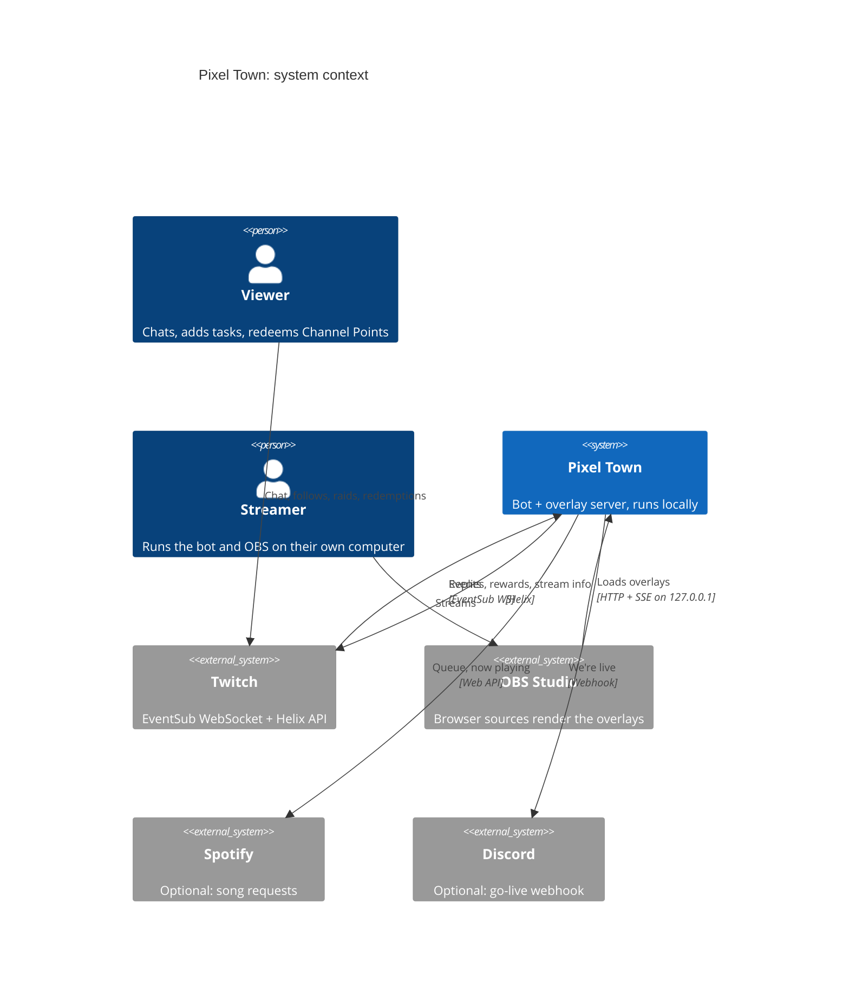
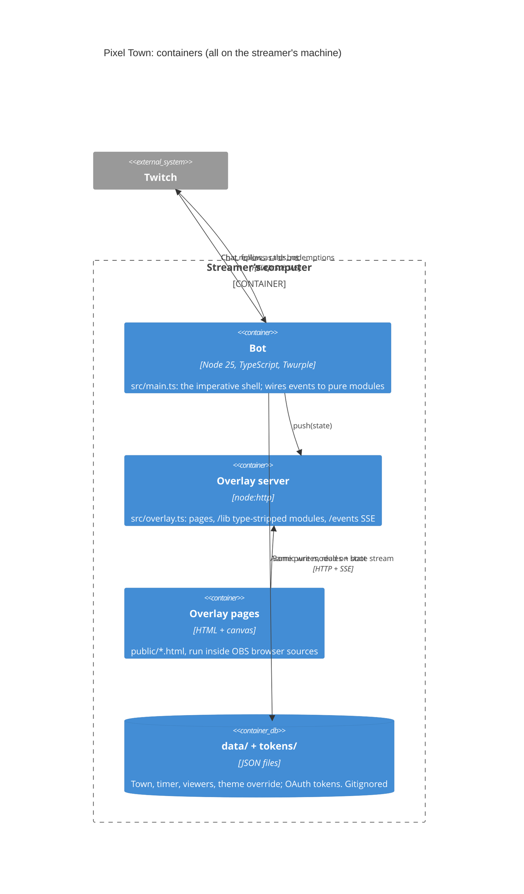
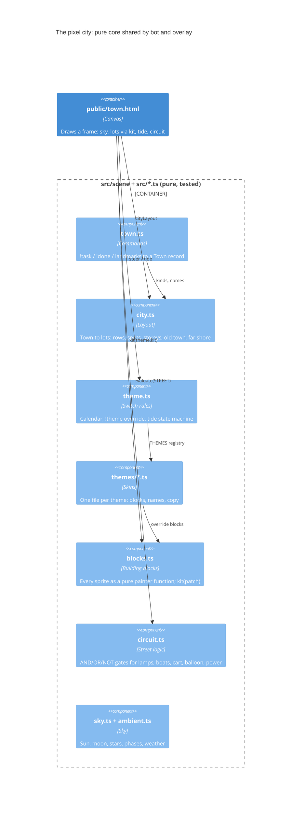
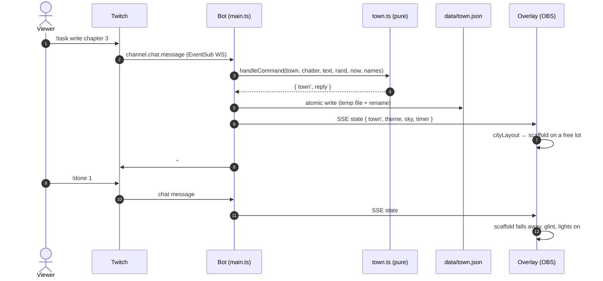
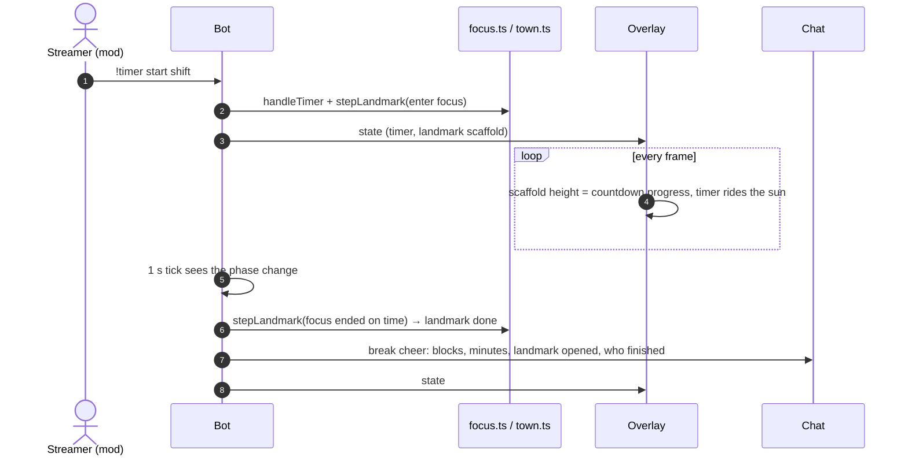
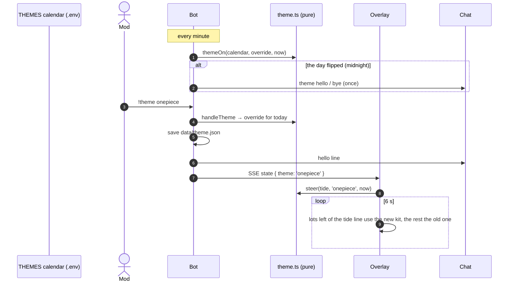

# Pixel Town: a cozy Twitch companion

A small, self-hosted Twitch bot plus OBS overlays for **co-working and study streams**. Viewers' tasks become buildings in a pixel-art city across the river, chatters walk the promenade as tiny builders, a research-backed focus timer rides the real sun and moon, and the whole city can change its look with **community themes**.

Runs on your own computer. No server, no subscription. MIT licensed.

Inspired by [PomodoroWorld](https://pomodoroworld.com). If you want a polished 3D world with no setup, go there. Pixel Town is a small open-source take where chat builds the city together.

## Quick start

**Just look at it (no Twitch account, 2 commands):**

```sh
npm install
npm run preview -- onepiece night     # → http://localhost:3005/town
```

**Run it on your channel (about 6 commands):** needs Node 23.6+ (runs TypeScript natively), the [Twitch CLI](https://dev.twitch.tv/docs/cli/) and OBS. Register an app at [dev.twitch.tv/console](https://dev.twitch.tv/console) first (verified email + 2FA). A separate bot account is recommended.

```sh
npm install
cp .env.example .env          # TWITCH_CLIENT_ID, TWITCH_CLIENT_SECRET, TWITCH_CHANNEL, TWITCH_BOT
twitch configure              # same Client ID + Secret
npm run login -- bot          # device code: approve in a browser logged in as the bot
npm run login -- channel      # same, as the broadcaster
npm start
```

Then type `/mod <botname>` in your chat and add the overlays below to OBS as **Browser** sources. A full first-time walkthrough (OBS, a GoPro as webcam, audio, troubleshooting) is in [docs/SETUP.md](docs/SETUP.md).

| Overlay URL | Size | Shows |
|---|---|---|
| `http://localhost:3001/town` | 1920×1080 | the city and sky, full screen with the old city behind by default (put it at the bottom of the scene); mods switch to a strip under the camera with `!view cam`. `?bg=` pins a view: `city`, `0` bottom, `1` opaque sky without the old city. `?land=alpine|coast|valley|mesa|archipelago|fjord` pins today's landscape. `?sky=0` buildings only, `?alpha=0.7` see-through |
| `http://localhost:3001/timer` | 600×200 | focus timer, hidden when idle (`?tall`: 380×480 panel, always shown, with the `!guess` neon art under the timer; `&piece=N` pins a piece) |
| `http://localhost:3001/music` | 600×140 | now-playing card |
| `http://localhost:3001/workout` | 600×160 | Channel Points workout queue |

Optional `.env` extras: `SUN_LAT`/`SUN_LON` (real sun, moon, stars and weather for your city), `THEMES` (theme days), Spotify (`SPOTIFY_CLIENT_ID`, `SPOTIFY_PLAYLIST`, then `npm run login:spotify`, Premium needed), links (`LINK_DISCORD`, `LINK_INSTA`, `LINK_PLAYLIST`) and a Discord go-live post (`DISCORD_WEBHOOK`). On macOS, `npm run launcher` builds a one-click app that starts the bot with OBS.

## Features

- **Pixel city.** Each `!task` rolls a SimCity-style building under airy scaffolding; `!done` makes it solid and lights it up. Low buildings line the riverfront, towers stand behind, the river mirrors it all. When the street is full, tasks become storeys on the shortest tower. Fresh city on the first go-live of each day; unfinished tasks carry over.
- **Focus landmarks.** The streamer's focus blocks build a landmark that rises with the countdown and opens at the break (longer blocks, grander landmarks). Stop or skip mid-block and it withers.
- **Real sky.** Sun, moon (in its real phase) and ~40 bright stars where they actually are for your city. Buildings turn their shaded side away from the brightest one; the timer lives in its own card, not in the sky.
- **Themes.** A calendar (or a mod) reskins the city for the day; the new look washes in as a tide. First theme: **Grand Line**, a One Piece homage. [Make your own](docs/THEMES.md).
- **Street logic.** Lamps, boats, the food cart and the balloon switch through a small AND/OR/NOT circuit (lamps on at night *or* in rain), with a power line on the promenade fed by finished buildings.
- **Builders.** Anyone who chatted in the last 30 minutes walks the street and hammers at their scaffolding. Follows send a delivery truck, raids arrive by bus.
- **Focus timer** with `shift`, `pomodoro` and `deep` presets and evidence-ranked break prompts ([docs/FOCUS.md](docs/FOCUS.md)).
- **Greetings, song requests (Spotify), Channel Points workouts, link commands, chat read aloud** for the streamer, and `!raid` ideas for small streams in your category.

## Chat commands

| Command | Who | What |
|---|---|---|
| `!task <text>` | anyone | put up a building (max 10 open each) |
| `!done 2` / `!done 1 3` / `!done` | anyone | finish one, several, or your only open task |
| `!tasks`, `!where`, `!help` | anyone | list yours, point at them on screen, how it works |
| `!cancel 2` (`!remove 2`) | anyone | take down an unfinished one |
| `!leave` / `!join` | anyone | hide / show your builder |
| `!theme` | anyone | today's theme and the theme calendar |
| `!theme <name>` / `off` / `auto` | mods | switch theme for today / plain city today / back to the calendar |
| `!view` / `!view city` / `!view cam` | anyone / mods | current view / full screen with the old city behind (default) / just the strip under the camera |
| `!newday` | mods | archive the city to `data/town-<date>.json`, keep unfinished tasks |
| `!timer` | anyone | current phase and time left |
| `!timer start [shift\|pomodoro\|deep]`, `pause`, `resume`, `skip`, `stop` | mods | control the focus timer |
| `!sr <song>`, `!song` | followers / anyone | request a song (1 per 10 min), what's playing |
| `!skip` | mods | skip the song |
| `!workout` / `!workout off\|on` | anyone / mods | the workout queue / pause the rewards (refunds while off) |
| `!guess <name>` | anyone | who is on the Focus panel? One Piece fan art in cyberpunk neon, told through objects (a hat, three swords...), new piece every 10 min, first right guess wins |
| `!raid` | mods | three small live streams in your category |
| `!tts on\|off` | mods | read chat aloud on the streamer's computer |
| `!socials`, `!discord`, `!insta`, `!playlist` | anyone | links |

## Architecture

Diagrams follow the [C4 model](https://c4model.com): context, containers, components.

### Context



### Containers



### Components (the city)



### A task, end to end



### A focus block builds a landmark



### A theme day



## Design decisions

| Decision | Why | Trade-off |
|---|---|---|
| **Self-hosted, local only** (overlay bound to 127.0.0.1) | No server bill, no account, nothing exposed to the internet | Runs only while the streamer's computer does |
| **EventSub WebSocket + Helix, not IRC** | Twitch's current recommendation; replies sent with the app token get the Chat Bot badge | Needs the bot to be a mod |
| **Functional core, imperative shell** | All rules are pure and unit-tested; Twitch, files and OBS sit at the edges in `main.ts` | Shell code is thin glue, tested by running it |
| **No bundler** | The overlay imports the same `src/*.ts` the tests run, type-stripped by Node per request | Browser-safe modules only in `src/scene` |
| **SSE full snapshots** | OBS unloads hidden sources; every (re)connect gets the whole state, no diffing | A few KB per push, fine at one push per change |
| **JSON files, atomic writes, corrupt file stops boot** | Human-readable, easy backups; never silently start empty and overwrite a city | Not for multiple machines |
| **Themes are skins** (same kinds and lots) | Saved cities, layout and tests stay valid across themes; contributors can't break the layout | A theme can't add new building kinds or sizes |
| **Building blocks as pure painter functions** | Testable without a canvas (the bounds test), overridable one block at a time | Sprites are code, not image files |
| **Calendar + mod override that expires at midnight** | Recurring theme days with no daily chore; a mod can always step in | Day granularity only, no date ranges yet |
| **Tide state machine (settled / turning), starts settled** | A visible but calm switch; OBS reloads never replay it | Mixed look for 6 s |
| **Street logic as a gate circuit** | Behaviour like "lamps on at night or in rain" is data, readable and testable | Gates are boolean; thresholds are inputs |
| **Shape carries state, calm motion** | Colourblind-safe; co-working viewers aren't distracted | No loud alerts by design |
| **Real desk, pixel world: one style per scene** | Focus = the real camera with a slim city band, Break = the full pixel city (`make obs-scenes`), switched by hand. One illustration style (pixel art), nothing covers the streamer or the desk robot | Tried and removed: an AI-painted anime room behind a person cutout; three styles in one frame read as cluttered, and it cost GPU and upkeep |

Decisions are logged as they happen in [CLAUDE.md](CLAUDE.md) (ledger); research notes are in [docs/](docs/).

## Development

`make` lists every command (each wraps an npm script, so `npm run …` works too).

```sh
make check                              # Vitest + tsc, run before every commit
make preview THEME=onepiece PHASE=night # overlay with a demo city, no Twitch (PORT=3005)
make docker-check                       # same checks in a clean Node 25 container
```

The bot runs on the host, not in Docker: it drives OBS, speaks with macOS `say` and logs in through a browser.

See [CONTRIBUTING.md](CONTRIBUTING.md). Themes: [docs/THEMES.md](docs/THEMES.md).

## License

[MIT](LICENSE). Themes inspired by other works are fan homages with original pixel art; all trademarks belong to their owners.
