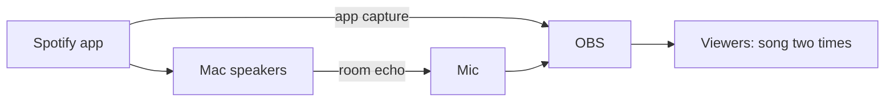
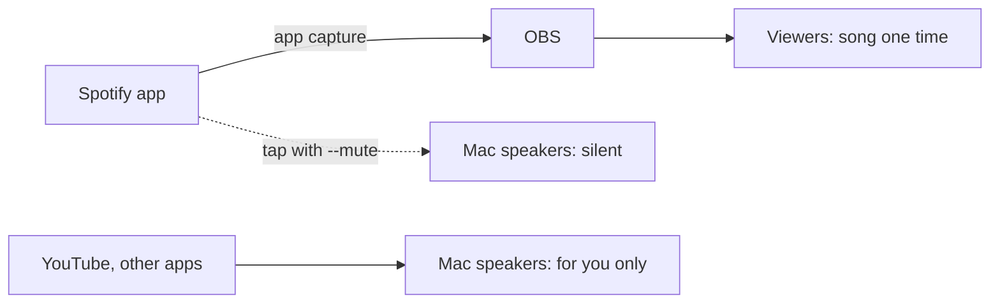
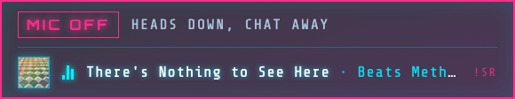
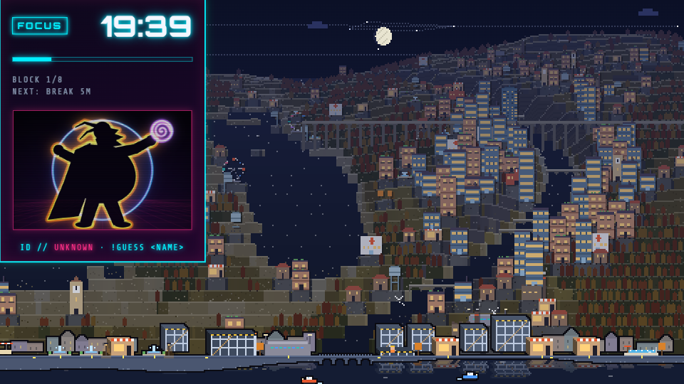

# Spotify for the stream, silence for the room

Spotify plays on the stream but not on your Mac speakers. The fix is free and open source. It uses a muted Core Audio process tap through [AudioTee](https://github.com/makeusabrew/audiotee) (MIT). Tested on macOS 26 with OBS 32, on 2026-10-22.

## The problem

Without headphones, the mic hears the speakers. Viewers then hear each song two times: one clean copy from OBS and one late copy with room echo. Noise suppression does not remove music.



## The fix

A process tap listens to one app. With `--mute`, the tap also stops that app on the speakers. OBS still captures the app at full level.



Measured result: the OBS Spotify meter stayed at about -17 dB with the tap on and with the tap off.

## Requirements

- macOS 14.2 or later.
- Xcode Command Line Tools: `xcode-select --install`.
- OBS with Spotify as a source: Sources, +, macOS Audio Capture, Mode: Application, Spotify.

## Procedure

1. Get AudioTee and build it:
   ```sh
   git clone https://github.com/makeusabrew/audiotee ~/audiotee
   cd ~/audiotee && swift build -c release
   ```
2. Start Spotify. Play a song.
3. Start the muted tap:
   ```sh
   ~/audiotee/.build/release/audiotee --include-processes $(pgrep -x Spotify) --mute > /dev/null
   ```
4. Give the permission. Open System Settings, Privacy & Security, Screen & System Audio Recording. Turn on your terminal app under "System Audio Recording Only". Restart the terminal. Do step 3 again.
5. Make sure that the speakers are silent.
6. Make sure that the Spotify meter in the OBS Audio Mixer still moves.
7. Keep the terminal open while you stream. To hear Spotify in the room again, push Ctrl+C.

## If in doubt

| Symptom | Cause | Action |
|---|---|---|
| Speakers still play Spotify, no error | No audio recording permission | Do step 4. Restart the terminal. |
| `Failed to translate process IDs` | Helper processes have no audio | Use `pgrep -x Spotify` (main process only), not `pgrep -f Spotify`. |
| `Invalid value ... for option: include-processes` (zsh) | zsh gave all IDs as one argument | Use `$(pgrep -x Spotify)` directly, not a variable. |
| Tap worked, then Spotify plays again | Spotify restarted and has a new process ID | Do step 3 again. |
| Tap worked, then Spotify plays again; OBS Spotify meter silent too | The Mac output device changed (headphones, a removed virtual device). The tap and the OBS capture stay on the old device. | Stop and start the tap. In OBS, set the Spotify source to another app and back. The switch script does both by itself. |
| OBS Spotify meter is silent | Spotify is turned down before OBS (per-app volume app, Spotify volume 0) | Set Spotify to full volume in other tools. Use the tap for the mute. |
| Mic is live in a scene without the mic | Mic is a global audio device: it plays in all scenes | Settings, Audio, Global Audio Devices, Mic/Auxiliary Audio: Disabled. Add the mic as a source to the talk scenes only. |

Two other approaches did not work for this:

- **Per-app volume (Background Music, free).** Spotify at 0 also silences the OBS capture.
- **Routing to a virtual speaker (SoundSource + BlackHole).** It works, but SoundSource is not free.

## Bonus: scenes that show the mic state

When the mic is a normal source, each scene controls it. A small HTML badge ([public/mic.html](../public/mic.html)) tells chat when the mic is off. It also shows the song playing (from the bot). Add it as an OBS browser source, 580x112, URL `http://localhost:3001/mic` (Focus) or `http://localhost:3001/mic?brb` (Break).

| Scene | Voice | Spotify on stream | Badge |
|---|---|---|---|
| Focus | off | on | MIC OFF |
| Notfocussed | on | on | none |
| Break | off | on | BRB |




The Break scene: the full pixel city replaces the camera. The BRB badge goes under the timer.



## Follow the scene

[scripts/spotify-quiet.ts](../scripts/spotify-quiet.ts) does the procedure for you. It watches the OBS scene over obs-websocket. In Focus and Break it starts the muted tap. In Notfocussed it stops the tap, so Spotify plays in the room while you talk. It taps Spotify again when Spotify restarts, and when the Mac output device changes it restarts the tap and the OBS Spotify capture. Run it with `make spotify-quiet`, or let the launcher start it with OBS.

In Notfocussed the script also drops the Spotify volume to a quarter, for the room and the stream together (OBS captures Spotify after its own volume). When you leave Notfocussed, it puts the volume back.
