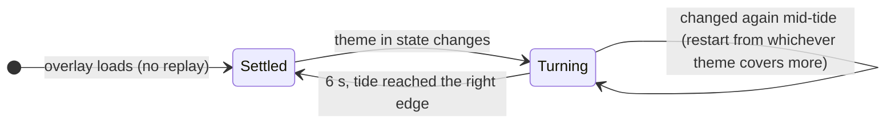

# Making a theme

A theme is a **skin over the same city**. Viewers' buildings keep their kind, their lot and their saved data; a theme only changes how they look, what chat calls them, and a few props (boats, the food cart, the balloon, the water). The plain city is drawn first; a theme lays its own blocks over the ones it names and leaves the rest alone.

The first theme is [`onepiece.ts`](../src/scene/themes/onepiece.ts) (Grand Line). Copy it.

## In four commands

```sh
git clone https://github.com/1xabhay/twitch_handler && cd twitch_handler
npm install
npm run preview -- onepiece day      # no Twitch account needed
# open http://localhost:3005/town?bg=1, edit, reload the page
```

The preview shows a finished demo city with every building kind. Type another theme name (or `plain`) in the terminal and press enter to watch the tide wash it in. Phases: `day`, `dawn`, `dusk`, `night`.

## Adding yours

1. **Copy** `src/scene/themes/onepiece.ts` to `src/scene/themes/<id>.ts` (`<id>` is lowercase, one word, it's what mods type: `!theme <id>`).
2. **Register** it in [`src/scene/theme.ts`](../src/scene/theme.ts): `import { yours } from './themes/yours.ts'` and add it to `THEMES`.
3. **Draw**: override only the blocks you want (see the reference below). Delete what you don't change; the plain block is used instead.
4. **Check**: `npm test` (the block test paints every theme and fails if a sprite leaves its lot), `npm run typecheck`, and look at it in the preview at `day` and `night`.
5. **Open a PR** with a day and a night screenshot.

Streamers turn a theme on with the calendar in `.env` (`THEMES=yours:sat,12-25`) or for one day with `!theme yours`.

## The rules

These keep themes swappable and the stream calm. The block test enforces the first one.

- **Reskin, never resize.** Every block must fit its lot (sizes below). The layout is computed once for all themes, so a bigger sprite would overlap its neighbour.
- **Same meaning, same shapes.** Finished = solid and lit (`C.lit` windows). Scaffolding is never themed; it's how viewers tell "in progress" from "done". State is carried by shape, not just colour (colourblind-safe).
- **Calm motion.** Animations step slowly (≥ 400 ms per frame, most use 1.5 to 3 s). No flashing, no fast loops. It's a co-working stream.
- **Pixel art at 1x.** The canvas is 480×270, scaled 4× with hard edges. Use whole pixels and flat colours; `rgba()` only for glows, smoke and beams.
- **Original art only.** Fan themes are welcome as *homages*: places, props, colours and small symbolic nods. Don't trace or copy sprites, logos or characters from games, shows or other artists, and don't draw recognisable characters. Say what inspired it in the file's first comment.
- **Chat copy** (`hello`, `bye`, `names`): playful, short, no em dashes (a test checks). `names` must read well after "a"/"an": `nameOf` picks the article.
- **Pure functions.** Blocks draw only through the painter `p`, with no `ctx`, `Date` or `Math.random`. Time comes in as `s.t` and `s.minute` so tests and the preview are deterministic.

## Reference

```ts
type Paint = (x, y, w, h, color: string) => void;  // fills a rectangle, coordinates rounded
type Scene = { t: number; night: boolean; season: 'spring'|'summer'|'autumn'|'winter'; minute: number };

type Theme = {
  name: string;                              // shown in !theme ("Grand Line")
  hello: string;                             // posted when the theme starts (calendar flip or !theme <id>)
  bye: string;                               // posted when it ends
  names: Partial<Record<Kind, string>>;      // what chat calls each kind ("lighthouse")
  kit: {                                     // every field optional
    lots?:    { [kind]: (p, x, y, s) => void };   // finished building; x = left edge, y = ground line, draw upward
    storey?:  { office?, apartment? };            // one 16×8 storey, x/y = its top-left (towers stack these)
    roof?:    (p, x, y, kind, t) => void;         // cap on a finished office/apartment tower, y = its roof line
    body?:    { [kind]: [dx, w, h, wallColour] | undefined }; // box behind a solid building for the 3D side wall; undefined = open shape
    boat?:    (p, x, y, color, dir, night) => void; // river boats (dir 1 = sailing right)
    cart?:    (p, x, y) => void;                  // food cart, y = ground line
    balloon?: (p, x, y, t) => void;               // drifts through the sky, x/y = top-left
    water?:   { day?: string; night?: string };   // river colour
  };
};
```

Colours shared with the plain city are in `C` from [`blocks.ts`](../src/scene/blocks.ts): `C.lit` (lit window), `C.shine` (night glow), `C.dark` (doors), `C.slab`, `C.garden`.

### Lot sizes (width × height, px)

| Kind | Size | Where it shows up |
|---|---|---|
| office, apartment | 16×16 | back row; extra tasks stack 16×8 storeys on these |
| house | 16×15 | front row |
| shop | 16×12 | front row; also a small landmark |
| factory | 24×22 | back row |
| park | 16×9 | front row |
| pool | 24×6 | front row; small landmark |
| arena | 32×15 | front row; grand landmark |
| school | 24×18 | back row; civic landmark |
| hospital | 20×20 | back row; civic landmark |
| watertower | 12×22 | back row |
| turbine | 12×28 | back row |
| fountain | 16×8 | front row; small landmark |
| clocktower | 14×34 | landmark only (civic) |
| skyscraper | 20×64 | landmark only (grand) |
| ferris | 28×30 | landmark only (grand) |

Small extras may poke up to 4 px out of the box (smoke, spires, floodlights); nothing may go below the ground line.

## How a theme turns on



Which theme is wanted: a mod's `!theme <id>|off` for today, otherwise the `THEMES` calendar, otherwise the plain city. The rules and the tide are pure functions in [`theme.ts`](../src/scene/theme.ts) with tests beside them.

## Ideas up for grabs

Seasonal (Halloween pumpkins and a haunted water tower, winter lights), lofi café, cyberpunk night market, Ghibli-style countryside (homage, no characters), space colony, underwater. Open an issue to claim one.
